<div align="center">

# Keyboard Maestro for Beginners

[中文](./README.md) · **English** · [日本語](./README.ja.md) · [한국어](./README.ko.md) · [Español](./README.es.md) · [Português](./README.pt.md) · [Français](./README.fr.md) · [Deutsch](./README.de.md) · [Русский](./README.ru.md) · [العربية](./README.ar.md)

### Get the most out of Keyboard Maestro: hand the repetitive stuff to one key

Keyboard Maestro is automation for the Mac: you write macros in the editor, and the Engine runs them in the background.<br>This guide follows the official Keyboard Maestro wiki and turns it into three short lessons, so someone who has never automated anything can follow along.

**[Start with lesson 1 →](https://keyboardmaestro.xiaoxiaodong.ai/en/start/1-first-macro/)**　·　**[Already using it? The full guide →](https://keyboardmaestro.xiaoxiaodong.ai/en/guide/0-what/)**

<sub>Unofficial · free · open source · 10 languages (the full site in Chinese and English; home and the three lessons in 8 more)</sub>

</div>

<p align="center">
  
</p>

## Sound familiar?

You open your Mac in the morning, click Calendar, open the web page you check every day, then drag each window to where you like it. During the day you type the same address and the same reply several times. Each time it's only a few seconds, but it's every day.

Keyboard Maestro hands all of that to macros. A macro says two things: when to start (its triggers) and what to do once it starts (its actions). From then on you press one key or type a few letters, and it does the steps for you. Macros live in macro groups, which are like folders that also decide in which apps, and when, their macros are active.

<p align="center">
  
</p>

## Two programs: one to write, one to run

Installing it gives you two programs. **Keyboard Maestro** is the editor: you open it when you want to write or change macros, it saves itself a few seconds after every change (there's no Save), and you can quit it when you're done. **Keyboard Maestro Engine** runs in the background all the time: it listens for your hot keys, watches the time, tracks which apps are running and keeps your clipboard history, and it's the part that actually runs your macros. If the Engine isn't running, nothing fires, so the official advice is to turn on **Launch Engine at Login** in the preferences.

<p align="center">
  
</p>

## Three lessons, one thing at a time

You don't need to code, and you don't need to learn a hundred actions first. Each lesson does one thing, and you leave with one more macro that works.

<p align="center">
  
</p>

1. **[Install it and open your favorite app with one key](https://keyboardmaestro.xiaoxiaodong.ai/en/start/1-first-macro/)** (15 minutes): Download it, grant the permissions, keep the Engine running, then build your first macro: one hot key that opens the app you use every day.
2. **[Type a few letters, get a whole paragraph](https://keyboardmaestro.xiaoxiaodong.ai/en/start/2-type-less/)** (10 minutes): The address, intro or reply you type every day goes into a typed string trigger: type a few letters and the whole text appears.
3. **[One key, a whole routine](https://keyboardmaestro.xiaoxiaodong.ai/en/start/3-one-key-routine/)** (15 minutes): Turn the clicks you make every morning into one macro: open a few apps and a web page, put the windows in place, then learn to stop it and where to look when it misfires.

## The full guide

Done with the lessons and want macros that adapt, a clipboard that remembers, and a way to find out why something didn't fire? Go through these in order:

| Step | Topic | In one line |
| --- | --- | --- |
| 0 | [What Keyboard Maestro is](https://keyboardmaestro.xiaoxiaodong.ai/en/guide/0-what/) | Automation for the Mac: you write macros in the editor and the Engine runs them in the background. Every macro is a when plus a what |
| 1 | [Macro groups: where macros work](https://keyboardmaestro.xiaoxiaodong.ai/en/guide/1-groups/) | A macro group is a folder that also decides when its macros are live: only in certain apps, only after you activate it, or shown as a palette |
| 2 | [Triggers: when a macro starts](https://keyboardmaestro.xiaoxiaodong.ai/en/guide/2-triggers/) | A hot key, a typed string, a time of day, an app launching, a Wi-Fi network, a new file in a folder: pick the moment that feels natural |
| 3 | [Actions: what a macro does](https://keyboardmaestro.xiaoxiaodong.ai/en/guide/3-actions/) | Typing, keystrokes, menus, apps, windows, clicks and files: meet the dozen actions you'll use most and search for the rest when you need them |
| 4 | [Variables, conditions and loops: macros that adapt](https://keyboardmaestro.xiaoxiaodong.ai/en/guide/4-variables/) | Remember some text, ask you a question, take a different path depending on what's on screen, wait for something to happen: a macro stops being a fixed string of keystrokes |
| 5 | [The clipboard: everything you copied is still there](https://keyboardmaestro.xiaoxiaodong.ai/en/guide/5-clipboard/) | Clipboard history lets you paste what you copied earlier, named clipboards keep a few things for good, and filters change text before you paste |
| 6 | [When a macro doesn't work](https://keyboardmaestro.xiaoxiaodong.ai/en/guide/6-debug/) | Check permissions and the Engine first, then whether the group is active. Still stuck? Step through with the debugger or read the Engine log |
| 7 | [Going further: scripts, subroutines, syncing and sharing](https://keyboardmaestro.xiaoxiaodong.ai/en/guide/7-advanced/) | Hook in shell scripts, AppleScript and JavaScript, turn repeated steps into subroutines, sync between two Macs, and share macros with others |

## How-to: specific jobs

- **Typing and text**: [Turn the things you type often into abbreviations](https://keyboardmaestro.xiaoxiaodong.ai/en/howto/text-snippets/) · [Insert today's date with one key](https://keyboardmaestro.xiaoxiaodong.ai/en/howto/insert-date/) · [Paste without the formatting](https://keyboardmaestro.xiaoxiaodong.ai/en/howto/paste-plain/) · [Fill in the same form with one key](https://keyboardmaestro.xiaoxiaodong.ai/en/howto/fill-form/)
- **Apps and windows**: [Jump to an app with one key](https://keyboardmaestro.xiaoxiaodong.ai/en/howto/app-hotkeys/) · [Put your windows where you want them](https://keyboardmaestro.xiaoxiaodong.ai/en/howto/window-layout/) · [Give a menu command a shortcut it doesn't have](https://keyboardmaestro.xiaoxiaodong.ai/en/howto/menu-shortcut/)
- **Files**: [Rename a batch of files](https://keyboardmaestro.xiaoxiaodong.ai/en/howto/rename-files/) · [File things away as soon as they land in a folder](https://keyboardmaestro.xiaoxiaodong.ai/en/howto/watch-folder/)
- **Screen and mouse**: [Find a button on screen and click it](https://keyboardmaestro.xiaoxiaodong.ai/en/howto/click-image/) · [Read the text off your screen](https://keyboardmaestro.xiaoxiaodong.ai/en/howto/ocr-text/)
- **On schedule**: [Run something at the same time every day](https://keyboardmaestro.xiaoxiaodong.ai/en/howto/daily-schedule/) · [Do something when you join a Wi-Fi network or plug in a device](https://keyboardmaestro.xiaoxiaodong.ai/en/howto/wifi-usb/)
- **Asking you first**: [Ask a question before doing the work](https://keyboardmaestro.xiaoxiaodong.ai/en/howto/ask-input/) · [Make a row of buttons that run macros](https://keyboardmaestro.xiaoxiaodong.ai/en/howto/palette/)
- **Keeping and sharing**: [Use the same macros on two Macs](https://keyboardmaestro.xiaoxiaodong.ai/en/howto/sync-macs/) · [Export, import and share macros](https://keyboardmaestro.xiaoxiaodong.ai/en/howto/share-macros/) · [When a macro won't stop](https://keyboardmaestro.xiaoxiaodong.ai/en/howto/stop-macro/)

Stuck on a word or unsure about something? Look it up in the **[Wiki](https://keyboardmaestro.xiaoxiaodong.ai/en/wiki/)** and the **[FAQ](https://keyboardmaestro.xiaoxiaodong.ai/en/faq/)**.

## Where this comes from

Every feature, option and menu path is checked against the [official Keyboard Maestro wiki](https://wiki.keyboardmaestro.com/), linked on the page. Button names are written exactly as the app shows them. The guide was checked against Keyboard Maestro 11.1.1 (2026-11-24), which needs macOS 10.13 or later. Experiences from the forum are quoted only as what someone tried, with a link.

This guide carries no license keys, cracks or download mirrors; download Keyboard Maestro from [its official website](https://www.keyboardmaestro.com/). It never tells you to switch off macOS security settings, and permissions are granted the way the official wiki describes.

This is an unofficial guide with no connection to Stairways Software, and it doesn't speak for them. Keyboard Maestro is a trademark of Stairways Software Pty Ltd. Features change, so the official wiki and the app itself are the reference.

## Run it locally

```bash
npm install
npm run dev        # http://localhost:4446
npm run build      # output in dist/
npm run check      # after a build: languages, the whole site, UI labels
```

The README pictures and share images are generated: `python3 tools/build_hero.py`, `python3 tools/build_readme_svgs.py` and `npm run og`; see 「README 插画和分享大图」 in [docs/MAINTAINING.md](docs/MAINTAINING.md) (in Chinese), which also covers the writing rules, sources, and the scripts that sync the official wiki and check button names. The site shell comes from [Saily for Beginners](https://github.com/nevertoday/xxd-saily) and [Grok Bot for Beginners](https://github.com/nevertoday/xxd-grokbot), and the interface uses the 小小东 UI Kit.

Code and text are MIT licensed, see [LICENSE](LICENSE). `public/xxd/` is build output of the 小小东 UI Kit and isn't covered by the MIT license; see `public/xxd/LICENSE`.
