<div align="center">

# Keyboard Maestro 入門ガイド

[中文](./README.md) · [English](./README.en.md) · **日本語** · [한국어](./README.ko.md) · [Español](./README.es.md) · [Português](./README.pt.md) · [Français](./README.fr.md) · [Deutsch](./README.de.md) · [Русский](./README.ru.md) · [العربية](./README.ar.md)

### Keyboard Maestro を使いこなそう：毎日の繰り返しを、キー1つに任せる

Keyboard Maestro は Mac の自動化ツールです。エディタでマクロを作り、バックグラウンドのエンジンが代わりに実行してくれます。<br>このガイドは Keyboard Maestro 公式 Wiki に沿って内容を3つの短いレッスンにまとめたものなので、自動化が初めてでもそのまま手を動かしながら進められます。

**[レッスン1から始める →](https://keyboardmaestro.xiaoxiaodong.ai/ja/start/1-first-macro/)**　·　**[すでに使っているなら完全ガイドへ →](https://keyboardmaestro.xiaoxiaodong.ai/ja/guide/0-what/)**

<sub>非公式 · 無料 · オープンソース · サイト全体が10言語対応</sub>

</div>

<p align="center">
  
</p>

## こんなこと、ありませんか？

朝、Mac を開いてカレンダーをクリックし、毎日見るウェブページを開いて、それぞれのウィンドウを好みの位置にドラッグする。日中は同じ住所や同じ返信を何度も打つ。1回はほんの数秒でも、それが毎日続きます。

Keyboard Maestro なら、そうした作業をすべてマクロに任せられます。マクロで決めておくのは、「いつ始めるか」（トリガー）と「始まったら何をするか」（アクション）の2つだけです。あとはキーを1つ押すか数文字打つだけで、手順を代わりに進めてくれます。マクロはマクログループの中に入れて整理します。フォルダのようなものですが、その中のマクロがどのアプリで、いつ有効になるかも決めています。

<p align="center">
  
</p>

## 2つのプログラム：書く役と、動かす役

インストールすると、2つのプログラムが入ります。**Keyboard Maestro** はエディタです。マクロを作ったり書き換えたりするときだけ開き、変更すると数秒後に自動で保存される（保存ボタンはありません）ので、終わったら終了してかまいません。もう1つの **Keyboard Maestro Engine** はバックグラウンドでずっと動いているエンジンです。ホットキーの入力を待ち、時刻を見守り、どのアプリが動いているかを把握し、クリップボード履歴も記録していて、実際にマクロを実行するのはこちらです。エンジンが動いていないとマクロは1つも反応しないため、公式でも設定で **Launch Engine at Login**（ログイン時にエンジンを起動）をオンにしておくよう案内しています。

<p align="center">
  
</p>

## 3つのレッスン、1つずつ順番に

コードを書く必要も、最初にアクションを100個覚える必要もありません。1つのレッスンで取り組むことは1つだけ。終えるたびに、実際に使えるマクロが1つ増えます。

<p align="center">
  
</p>

1. **[インストールして、よく使うアプリをキー1つで開く](https://keyboardmaestro.xiaoxiaodong.ai/ja/start/1-first-macro/)**（15分）：ダウンロードして権限を許可し、エンジンを動かし続けられるようにしてから、最初のマクロを作ります。毎日開くアプリを1つのホットキーで起動できるようになります。
2. **[数文字打つだけで、まとまった文章を出す](https://keyboardmaestro.xiaoxiaodong.ai/ja/start/2-type-less/)**（10分）：毎日打っている住所や自己紹介、定型返信を入力文字列トリガーに登録します。数文字打つだけで、文章がまるごと出てきます。
3. **[キー1つで、一連の作業をまとめてこなす](https://keyboardmaestro.xiaoxiaodong.ai/ja/start/3-one-key-routine/)**（15分）：毎朝くり返しているクリック操作を1つのマクロにまとめます。いくつかのアプリとウェブページを開いてウィンドウを所定の位置に並べ、さらにマクロを途中で止める方法や、うまく動かないときに確認する場所も覚えます。

## 完全ガイド

3つのレッスンを終えて、状況に合わせて動くマクロや履歴を覚えてくれるクリップボード、動かないときの原因の調べ方まで知りたくなったら、こちらを順番に読み進めてみてください。

| ステップ | テーマ | ひと言でいうと |
| --- | --- | --- |
| 0 | [Keyboard Maestro とは](https://keyboardmaestro.xiaoxiaodong.ai/ja/guide/0-what/) | Mac の自動化ツールです。エディタでマクロを作り、バックグラウンドのエンジンが実行します。どのマクロも「いつ」と「何をするか」の組み合わせです |
| 1 | [マクログループ：マクロが効く範囲](https://keyboardmaestro.xiaoxiaodong.ai/ja/guide/1-groups/) | マクログループはフォルダであり、中のマクロがいつ有効になるかも決めます。特定のアプリの中だけ、自分で有効にしたあとだけ、あるいはパレットとして表示する、といった具合です |
| 2 | [トリガー：マクロが動き出すタイミング](https://keyboardmaestro.xiaoxiaodong.ai/ja/guide/2-triggers/) | ホットキー、入力文字列、決まった時刻、アプリの起動、Wi-Fi ネットワーク、フォルダへの新しいファイル追加など、いちばん自然なタイミングを選べます |
| 3 | [アクション：マクロがやること](https://keyboardmaestro.xiaoxiaodong.ai/ja/guide/3-actions/) | 文字入力、キー操作、メニュー選択、アプリ、ウィンドウ、クリック、ファイル操作など。よく使う十数個をまず押さえて、残りは必要なときに調べれば十分です |
| 4 | [変数・条件・ループ：状況に合わせて動くマクロ](https://keyboardmaestro.xiaoxiaodong.ai/ja/guide/4-variables/) | 文字を覚えておく、実行前に質問する、画面の状態によって動きを変える、何かが起きるまで待つ。マクロが、決まったキー操作をなぞるだけのものではなくなります |
| 5 | [クリップボード：コピーしたものは全部残っている](https://keyboardmaestro.xiaoxiaodong.ai/ja/guide/5-clipboard/) | クリップボード履歴から以前コピーしたものを貼り付け直したり、名前付きクリップボードに定番の項目をずっと残しておいたり、貼り付ける前にフィルタで文字を加工したりできます |
| 6 | [マクロがうまく動かないとき](https://keyboardmaestro.xiaoxiaodong.ai/ja/guide/6-debug/) | まず権限とエンジンを確認し、次にマクログループが有効かを見ます。それでも解決しなければ、デバッガで1ステップずつ追うか、エンジンログを読みます |
| 7 | [さらに先へ：スクリプト、サブルーチン、同期と共有](https://keyboardmaestro.xiaoxiaodong.ai/ja/guide/7-advanced/) | シェルスクリプトや AppleScript、JavaScript を組み込み、よく使う手順をサブルーチンにまとめ、2台の Mac で同期したり、ほかの人とマクロを共有したりできます |

## ハウツー：具体的なやり方

- **文字入力とテキスト**：[よく打つ文章を短縮入力にする](https://keyboardmaestro.xiaoxiaodong.ai/ja/howto/text-snippets/) · [キー1つで今日の日付を入力する](https://keyboardmaestro.xiaoxiaodong.ai/ja/howto/insert-date/) · [書式なしで貼り付ける](https://keyboardmaestro.xiaoxiaodong.ai/ja/howto/paste-plain/) · [同じフォームをキー1つで入力する](https://keyboardmaestro.xiaoxiaodong.ai/ja/howto/fill-form/)
- **アプリとウィンドウ**：[キー1つでアプリに切り替える](https://keyboardmaestro.xiaoxiaodong.ai/ja/howto/app-hotkeys/) · [ウィンドウを思い通りの位置に配置する](https://keyboardmaestro.xiaoxiaodong.ai/ja/howto/window-layout/) · [ショートカットのないメニュー項目にショートカットを付ける](https://keyboardmaestro.xiaoxiaodong.ai/ja/howto/menu-shortcut/)
- **ファイル**：[複数のファイル名をまとめて変える](https://keyboardmaestro.xiaoxiaodong.ai/ja/howto/rename-files/) · [フォルダにファイルが入ったら自動で仕分ける](https://keyboardmaestro.xiaoxiaodong.ai/ja/howto/watch-folder/)
- **画面とマウス**：[画面上のボタンを見つけてクリックする](https://keyboardmaestro.xiaoxiaodong.ai/ja/howto/click-image/) · [画面に映った文字を読み取る](https://keyboardmaestro.xiaoxiaodong.ai/ja/howto/ocr-text/)
- **決まったタイミング**：[毎日同じ時刻に自動で実行する](https://keyboardmaestro.xiaoxiaodong.ai/ja/howto/daily-schedule/) · [Wi-Fi につないだときや、機器を差し込んだときに実行する](https://keyboardmaestro.xiaoxiaodong.ai/ja/howto/wifi-usb/)
- **実行前に尋ねる**：[作業の前に質問する](https://keyboardmaestro.xiaoxiaodong.ai/ja/howto/ask-input/) · [マクロを動かすボタンを並べて表示する](https://keyboardmaestro.xiaoxiaodong.ai/ja/howto/palette/)
- **保管と共有**：[2台の Mac で同じマクロを使う](https://keyboardmaestro.xiaoxiaodong.ai/ja/howto/sync-macs/) · [マクロを書き出す・読み込む・共有する](https://keyboardmaestro.xiaoxiaodong.ai/ja/howto/share-macros/) · [マクロが止まらなくなったとき](https://keyboardmaestro.xiaoxiaodong.ai/ja/howto/stop-macro/)

わからない言葉や気になることがあれば、**[Wiki](https://keyboardmaestro.xiaoxiaodong.ai/ja/wiki/)** や **[FAQ](https://keyboardmaestro.xiaoxiaodong.ai/ja/faq/)** で調べられます。

## このガイドの情報源

機能やオプション、メニューの場所はすべて [Keyboard Maestro 公式 Wiki](https://wiki.keyboardmaestro.com/) と照らし合わせて確認し、各ページにリンクを載せています。ボタンの名前は、アプリに表示されるとおりに書いています。内容は Keyboard Maestro 11.1.1（2026-11-24）を基準に確認しており、動作には macOS 10.13 以降が必要です。フォーラムの体験談は「実際に試した人の例」として引用するだけにとどめ、リンクを添えています。

このガイドではライセンスキーやクラック、非公式のダウンロードミラーは一切扱っていません。Keyboard Maestro は[公式サイト](https://www.keyboardmaestro.com/)からダウンロードしてください。また、macOS のセキュリティ設定をオフにする手順は載せておらず、権限の許可も公式 Wiki に書かれている手順どおりに行います。

このサイトは Stairways Software とは無関係の非公式ガイドであり、公式の見解を代表するものではありません。Keyboard Maestro は Stairways Software Pty Ltd の商標です。機能は変わることがあるため、正確な仕様は公式 Wiki とアプリ本体を基準にしてください。

## ローカルで動かす

```bash
npm install
npm run dev        # http://localhost:4446
npm run build      # dist/ に出力
npm run check      # ビルド後に実行：多言語、サイト全体、UI ラベルを確認
```

README の図版やシェア用画像はスクリプトで生成しています（`python3 tools/build_hero.py`、`python3 tools/build_readme_svgs.py`、`npm run og`）。詳しくは [docs/MAINTAINING.md](docs/MAINTAINING.md)（中国語）の「README 插画和分享大图」を見てください。執筆ルールや情報源、公式 Wiki の同期スクリプトやボタン名のチェックスクリプトについてもそこにまとまっています。サイトの骨組みは [Saily 入門ガイド](https://github.com/nevertoday/xxd-saily)と [Grok Bot 入門ガイド](https://github.com/nevertoday/xxd-grokbot)を引き継いでおり、インターフェースには小小东 UI Kit を使っています。

コードと文章は MIT ライセンスで公開しています（詳しくは [LICENSE](LICENSE) を見てください）。`public/xxd/` は小小东 UI Kit のビルド出力であり、MIT ライセンスの対象外です。詳しくは `public/xxd/LICENSE` を見てください。
