<div align="center">

# 처음 쓰는 Keyboard Maestro

[中文](./README.md) · [English](./README.en.md) · [日本語](./README.ja.md) · **한국어** · [Español](./README.es.md) · [Português](./README.pt.md) · [Français](./README.fr.md) · [Deutsch](./README.de.md) · [Русский](./README.ru.md) · [العربية](./README.ar.md)

### Keyboard Maestro 제대로 쓰기: 반복되는 일은 키 하나에 맡기기

Keyboard Maestro는 Mac용 자동화 도구예요. 편집기에서 매크로를 만들어 두면, 엔진이 백그라운드에서 대신 실행해 줘요.<br>이 가이드는 공식 Keyboard Maestro Wiki를 바탕으로 짧은 레슨 세 개로 정리했어요. 자동화를 한 번도 해 본 적 없는 사람도 그대로 따라 할 수 있어요.

**[레슨 1부터 시작하기 →](https://keyboardmaestro.xiaoxiaodong.ai/ko/start/1-first-macro/)**　·　**[이미 쓰고 있다면? 전체 가이드(영어) →](https://keyboardmaestro.xiaoxiaodong.ai/en/guide/0-what/)**

<sub>비공식 · 무료 · 오픈 소스 · 10개 언어(전체 사이트는 중국어와 영어, 홈과 입문 레슨 3개는 다른 8개 언어로도)</sub>

</div>

<p align="center">
  
</p>

## 이런 적 있으시죠

아침에 Mac을 켜면 먼저 캘린더를 클릭하고, 매일 확인하는 웹페이지를 연 다음, 창마다 편한 자리로 끌어다 놓아요. 일하는 중에는 똑같은 주소나 똑같은 답장을 하루에도 몇 번씩 다시 치곤 하죠. 한 번에 몇 초밖에 안 걸리지만, 매일같이 반복되는 일이에요.

Keyboard Maestro는 이런 일을 전부 매크로에 맡겨요. 매크로는 딱 두 가지를 정해 두는 거예요. 언제 시작할지(트리거)와 시작하면 무엇을 할지(동작)죠. 한 번 만들어 두면 그다음부터는 키를 한 번 누르거나 몇 글자만 쳐도 알아서 차례대로 해 줘요. 매크로는 매크로 그룹 안에 모아 두는데, 폴더처럼 정리하는 역할에 더해 그 안의 매크로가 어떤 앱에서 언제 작동할지도 함께 정해 줘요.

<p align="center">
  
</p>

## 프로그램 두 개: 하나는 만들고, 하나는 실행해요

설치하면 프로그램이 두 개 생겨요. **Keyboard Maestro**는 편집기예요. 매크로를 새로 만들거나 고칠 때만 열어 쓰면 되고, 내용을 바꾸면 몇 초 뒤에 알아서 저장돼서 따로 저장 버튼도 없어요. 할 일을 마치면 종료해도 괜찮아요. **Keyboard Maestro Engine**은 백그라운드에서 계속 켜져 있어요. 단축키 입력을 기다리고, 시간을 보고, 어떤 앱이 실행 중인지 살피고, 클립보드 기록을 챙기면서 실제로 매크로를 실행하는 역할을 해요. 엔진이 켜져 있지 않으면 매크로가 하나도 작동하지 않아요. 그래서 공식적으로도 설정에서 **Launch Engine at Login**(로그인 시 엔진 실행)을 켜 두라고 권해요.

<p align="center">
  
</p>

## 레슨 세 개, 한 번에 하나씩

코딩을 알 필요도 없고, 동작 백 가지를 미리 배울 필요도 없어요. 레슨마다 딱 한 가지만 다루고, 끝날 때마다 바로 쓸 수 있는 매크로가 하나씩 늘어나요.

<p align="center">
  
</p>

1. **[설치하고 키 하나로 자주 쓰는 앱 열기](https://keyboardmaestro.xiaoxiaodong.ai/ko/start/1-first-macro/)**(15분): 앱을 내려받고 권한을 준 뒤 엔진이 계속 켜져 있게 설정하고, 첫 번째 매크로를 만들어요. 매일 여는 앱을 단축키 하나로 띄울 수 있어요.
2. **[몇 글자만 쳐서 한 문단 입력하기](https://keyboardmaestro.xiaoxiaodong.ai/ko/start/2-type-less/)**(10분): 매일 반복해서 치는 주소나 자기소개, 답장을 문자열 입력 트리거에 넣어 두어요. 몇 글자만 치면 전체 문장이 알아서 입력돼요.
3. **[키 하나로 루틴 한 번에 끝내기](https://keyboardmaestro.xiaoxiaodong.ai/ko/start/3-one-key-routine/)**(15분): 매일 아침 클릭하던 과정을 매크로 하나로 묶어 앱 몇 개와 웹페이지를 열고 창까지 제자리에 놓아요. 실행 중인 매크로를 멈추는 법과 잘 안 될 때 어디를 보면 되는지도 함께 배워요.

## 전체 가이드(영어)

입문 레슨을 마치고 상황에 맞게 움직이는 매크로, 복사한 내용을 기억하는 클립보드, 매크로가 왜 실행되지 않았는지 찾는 법까지 알고 싶다면 아래 순서대로 살펴보세요.

| 단계 | 주제 | 한 줄 요약 |
| --- | --- | --- |
| 0 | [Keyboard Maestro란 무엇인가요](https://keyboardmaestro.xiaoxiaodong.ai/en/guide/0-what/) | Mac용 자동화 도구예요. 편집기에서 매크로를 만들면 엔진이 백그라운드에서 실행해 줘요. 모든 매크로는 ‘언제’와 ‘무엇을’로 이루어져 있어요 |
| 1 | [매크로 그룹: 매크로가 작동하는 범위](https://keyboardmaestro.xiaoxiaodong.ai/en/guide/1-groups/) | 매크로 그룹은 폴더이면서 매크로가 언제 켜질지도 정해요. 특정 앱에서만, 직접 켰을 때만, 또는 팔레트로 띄워 두고 쓸 수 있어요 |
| 2 | [트리거: 매크로가 시작되는 시점](https://keyboardmaestro.xiaoxiaodong.ai/en/guide/2-triggers/) | 단축키, 입력 문자열, 정해진 시각, 앱 실행, Wi-Fi 연결, 폴더에 새 파일이 들어올 때 등, 가장 자연스러운 시점을 고르면 돼요 |
| 3 | [동작: 매크로가 하는 일](https://keyboardmaestro.xiaoxiaodong.ai/en/guide/3-actions/) | 글자 입력, 키 입력, 메뉴, 앱, 창, 클릭, 파일 다루기까지 가장 자주 쓰는 동작 열두 가지 정도를 먼저 익히고, 나머지는 필요할 때 검색해서 쓰면 돼요 |
| 4 | [변수, 조건, 반복: 상황에 맞게 움직이는 매크로](https://keyboardmaestro.xiaoxiaodong.ai/en/guide/4-variables/) | 글자를 기억해 두거나, 실행 전에 질문을 띄우거나, 화면 상태에 따라 다른 길로 가고, 어떤 일이 일어날 때까지 기다리게 할 수 있어요. 매크로가 더 이상 고정된 키 입력 묶음에 머물지 않아요 |
| 5 | [클립보드: 복사한 내용이 모두 남아 있어요](https://keyboardmaestro.xiaoxiaodong.ai/en/guide/5-clipboard/) | 클립보드 기록으로 예전에 복사한 내용을 다시 붙여넣고, 이름 지정 클립보드에 자주 쓰는 항목을 오래 보관하고, 필터로 붙여넣기 전에 글자를 다듬을 수 있어요 |
| 6 | [매크로가 작동하지 않을 때](https://keyboardmaestro.xiaoxiaodong.ai/en/guide/6-debug/) | 권한과 엔진 상태를 먼저 확인하고, 그다음 매크로 그룹이 활성 상태인지 살펴봐요. 그래도 막히면 디버거로 한 단계씩 밟아 보거나 엔진 로그를 확인하면 돼요 |
| 7 | [더 깊이 들어가기: 스크립트, 서브루틴, 동기화와 공유](https://keyboardmaestro.xiaoxiaodong.ai/en/guide/7-advanced/) | 셸 스크립트, AppleScript, JavaScript를 연결하고, 반복되는 단계는 서브루틴으로 묶고, 두 대의 Mac 사이에서 동기화하거나 다른 사람과 매크로를 공유해요 |

## 활용법: 구체적인 작업(영어)

- **입력과 텍스트**: [자주 치는 문구를 약어로 만들기](https://keyboardmaestro.xiaoxiaodong.ai/en/howto/text-snippets/) · [키 하나로 오늘 날짜 입력하기](https://keyboardmaestro.xiaoxiaodong.ai/en/howto/insert-date/) · [서식 없이 붙여넣기](https://keyboardmaestro.xiaoxiaodong.ai/en/howto/paste-plain/) · [반복되는 양식 키 하나로 채우기](https://keyboardmaestro.xiaoxiaodong.ai/en/howto/fill-form/)
- **앱과 창**: [키 하나로 원하는 앱 바로 전환하기](https://keyboardmaestro.xiaoxiaodong.ai/en/howto/app-hotkeys/) · [창을 원하는 자리에 배치하기](https://keyboardmaestro.xiaoxiaodong.ai/en/howto/window-layout/) · [단축키가 없는 메뉴에 단축키 달아 주기](https://keyboardmaestro.xiaoxiaodong.ai/en/howto/menu-shortcut/)
- **파일**: [파일 이름 한꺼번에 바꾸기](https://keyboardmaestro.xiaoxiaodong.ai/en/howto/rename-files/) · [폴더에 파일이 들어오면 바로 정리하기](https://keyboardmaestro.xiaoxiaodong.ai/en/howto/watch-folder/)
- **화면과 마우스**: [화면에서 버튼 찾아 클릭하기](https://keyboardmaestro.xiaoxiaodong.ai/en/howto/click-image/) · [화면 속 글자 읽어 내기](https://keyboardmaestro.xiaoxiaodong.ai/en/howto/ocr-text/)
- **정해진 때에 실행**: [매일 같은 시각에 자동 실행하기](https://keyboardmaestro.xiaoxiaodong.ai/en/howto/daily-schedule/) · [Wi-Fi에 연결되거나 기기를 꽂을 때 자동 실행하기](https://keyboardmaestro.xiaoxiaodong.ai/en/howto/wifi-usb/)
- **먼저 물어보고 실행**: [작업 전에 먼저 질문 띄우기](https://keyboardmaestro.xiaoxiaodong.ai/en/howto/ask-input/) · [매크로를 실행하는 버튼 줄 만들기](https://keyboardmaestro.xiaoxiaodong.ai/en/howto/palette/)
- **보관과 공유**: [두 대의 Mac에서 같은 매크로 쓰기](https://keyboardmaestro.xiaoxiaodong.ai/en/howto/sync-macs/) · [매크로 내보내기, 가져오기, 공유하기](https://keyboardmaestro.xiaoxiaodong.ai/en/howto/share-macros/) · [매크로가 멈추지 않을 때](https://keyboardmaestro.xiaoxiaodong.ai/en/howto/stop-macro/)

모르는 용어나 헷갈리는 부분이 있으면 [**위키(영어)**](https://keyboardmaestro.xiaoxiaodong.ai/en/wiki/)와 [**FAQ(영어)**](https://keyboardmaestro.xiaoxiaodong.ai/en/faq/)에서 찾아보세요.

## 내용의 출처

모든 기능과 옵션, 메뉴 경로는 [공식 Keyboard Maestro Wiki](https://wiki.keyboardmaestro.com/)와 맞춰 확인했고, 각 페이지에 원문 링크를 달아 두었어요. 버튼 이름은 앱에 표시되는 그대로 적었어요. 이 가이드는 Keyboard Maestro 11.1.1(2026-11-24) 기준으로 확인했으며, 이 버전은 macOS 10.13 이상이 필요해요. 포럼에 올라온 경험담은 누군가 직접 해 본 사례로만 출처 링크와 함께 인용해요.

이 가이드에는 라이선스 키, 크랙, 다운로드 미러가 없어요. Keyboard Maestro는 [공식 웹사이트](https://www.keyboardmaestro.com/)에서 내려받으세요. macOS 보안 설정을 끄라고 안내하지 않으며, 권한은 공식 Wiki에 안내된 방식 그대로 부여해요.

이 가이드는 비공식 문서로 Stairways Software와 아무 관계가 없으며, Stairways Software의 입장을 대변하지도 않아요. Keyboard Maestro는 Stairways Software Pty Ltd의 상표예요. 기능은 바뀔 수 있으니 공식 Wiki와 앱 자체를 기준으로 삼으세요.

## 로컬에서 실행하기

```bash
npm install
npm run dev        # http://localhost:4446
npm run build      # dist/에 출력
npm run check      # 빌드 후 실행: 다국어, 전체 사이트, UI 이름 검사
```

README 이미지와 공유용 이미지는 스크립트로 생성해요. `python3 tools/build_hero.py`, `python3 tools/build_readme_svgs.py`, `npm run og`를 실행하면 돼요. 자세한 내용은 [docs/MAINTAINING.md](docs/MAINTAINING.md)(중국어)의 「README 插画和分享大图」 항목을 참고하세요. 글쓰기 규칙과 자료 출처, 공식 Wiki를 동기화하고 버튼 이름을 검사하는 스크립트도 이 문서에 정리되어 있어요. 사이트 뼈대는 [처음 쓰는 Saily](https://github.com/nevertoday/xxd-saily)와 [처음 쓰는 Grok Bot](https://github.com/nevertoday/xxd-grokbot)에서 가져왔고, 인터페이스는 小小东 UI Kit를 써요.

코드와 글은 MIT 라이선스를 따르며 자세한 내용은 [LICENSE](LICENSE)에서 볼 수 있어요. `public/xxd/`는 小小东 UI Kit의 빌드 결과물이라 MIT 라이선스 대상이 아니에요. 자세한 내용은 `public/xxd/LICENSE`를 참고하세요.
