<div align="center">

# Keyboard Maestro 新手教程

**中文** · [English](./README.en.md)

### 如何爽用 Keyboard Maestro：重复的事，交给一个键

Keyboard Maestro 是 Mac 上的自动化工具：你在编辑器里写宏，后台的引擎替你跑。<br>这个教程对照 Keyboard Maestro 官方 Wiki，把它讲成三节课，从来没做过自动化的人也能跟着做完。

**[从第 1 课开始 →](https://keyboardmaestro.xiaoxiaodong.ai/start/1-first-macro/)**　·　**[已经在用了，看完整教程 →](https://keyboardmaestro.xiaoxiaodong.ai/guide/0-what/)**

<sub>非官方 · 免费 · 开源 · 中文和英文</sub>

</div>

<p align="center">
  
</p>

## 你可能也这样

早上打开电脑，先点开日历，再打开那个每天都看的网页，再把窗口一个个拖到顺手的位置。一天里，同一段地址、同一句回复要打好几遍。每次只花几秒，可是天天都在重复。

Keyboard Maestro 把这些交给宏。一个宏写清两件事：什么时候开始（触发器），开始以后做什么（动作）。以后按一个键、打几个字母，它就替你一步步做完。宏放在宏组里，宏组像文件夹，还管着里面的宏在哪些 App 里、什么时候生效。

<p align="center">
  
</p>

## 两个程序，一个写，一个跑

装好以后你会有两个程序。**Keyboard Maestro** 是编辑器，写宏、改宏时才打开，改完几秒就自动存好，没有保存按钮，改完可以关掉。**Keyboard Maestro Engine** 是引擎，在后台一直开着，听你按的热键、看时间、盯着哪个 App 开了、记下剪贴板历史，真正执行宏的是它。引擎没开，宏就都不灵，所以官方建议在偏好设置里打开 **Launch Engine at Login**。

<p align="center">
  
</p>

## 三节课，跟着做就会

不用会写代码，也不用先认识一百个动作。一节课只做一件事，做完你手里就多一个能用的宏。

<p align="center">
  
</p>

1. **[装好它，按一个键打开常用的 App](https://keyboardmaestro.xiaoxiaodong.ai/start/1-first-macro/)**（15 分钟）：下载、给权限、让引擎一直开着，然后做出你的第一个宏：一个热键，打开你每天都要开的那个 App。
2. **[打几个字，出来一整段](https://keyboardmaestro.xiaoxiaodong.ai/start/2-type-less/)**（10 分钟）：每天重复打的地址、自我介绍、回复，交给一个输入字符串触发器：打出几个字母，整段文字自己出现。
3. **[一个键，做完一串事](https://keyboardmaestro.xiaoxiaodong.ai/start/3-one-key-routine/)**（15 分钟）：把每天开工要点的那几下排成一个宏：打开几个 App、打开一个网页、把窗口摆好；再学会让它停下、不灵时去哪看。

## 完整教程

做完三课，想让宏看情况办事、管好剪贴板、查出哪里不灵，按顺序往下走：

| 步 | 讲什么 | 一句话 |
| --- | --- | --- |
| 0 | [Keyboard Maestro 是什么](https://keyboardmaestro.xiaoxiaodong.ai/guide/0-what/) | Mac 上的自动化工具：编辑器里写宏，后台的引擎替你跑；每个宏就是「什么时候」加「做什么」 |
| 1 | [宏组：宏在哪里生效](https://keyboardmaestro.xiaoxiaodong.ai/guide/1-groups/) | 宏组像文件夹，又管着开关：只在某个 App 里生效、按一下才生效、显示成面板 |
| 2 | [触发器：什么时候开始](https://keyboardmaestro.xiaoxiaodong.ai/guide/2-triggers/) | 热键、打出的字、时间、打开某个 App、连上某个 Wi-Fi、文件夹里来了新文件……选一个最自然的时机 |
| 3 | [动作：它替你做什么](https://keyboardmaestro.xiaoxiaodong.ai/guide/3-actions/) | 打字、按键、选菜单、开 App、摆窗口、点鼠标、动文件：先认识最常用的十几个动作，其余的遇到再搜 |
| 4 | [变量、条件和循环：让宏看情况办事](https://keyboardmaestro.xiaoxiaodong.ai/guide/4-variables/) | 记住一段文字，问你一句话，看情况走不同的路，等某件事发生再往下：宏从此不只是一串固定的按键 |
| 5 | [剪贴板：复制过的都还在](https://keyboardmaestro.xiaoxiaodong.ai/guide/5-clipboard/) | 剪贴板历史让你贴回前几次复制的东西；命名剪贴板替你长期保管几段常用内容；粘贴前还能先改一改 |
| 6 | [宏不灵的时候](https://keyboardmaestro.xiaoxiaodong.ai/guide/6-debug/) | 先看权限和引擎，再看宏组有没有生效；还不行，用调试器一步一步走，或者翻引擎日志 |
| 7 | [再往深走：脚本、子程序、同步和分享](https://keyboardmaestro.xiaoxiaodong.ai/guide/7-advanced/) | 接上 Shell、AppleScript 和 JavaScript，把常用的几步做成子程序，在两台 Mac 之间同步，把宏分享给别人 |

## How-to：具体的事怎么做

- **打字和文字**：[把常打的话做成缩写](https://keyboardmaestro.xiaoxiaodong.ai/howto/text-snippets/) · [一键插入今天的日期](https://keyboardmaestro.xiaoxiaodong.ai/howto/insert-date/) · [粘贴时去掉格式](https://keyboardmaestro.xiaoxiaodong.ai/howto/paste-plain/) · [重复的表格一键填好](https://keyboardmaestro.xiaoxiaodong.ai/howto/fill-form/)
- **App 和窗口**：[一个键切到某个 App](https://keyboardmaestro.xiaoxiaodong.ai/howto/app-hotkeys/) · [把窗口摆到固定的位置](https://keyboardmaestro.xiaoxiaodong.ai/howto/window-layout/) · [给没有快捷键的菜单配一个](https://keyboardmaestro.xiaoxiaodong.ai/howto/menu-shortcut/)
- **文件**：[批量给文件改名](https://keyboardmaestro.xiaoxiaodong.ai/howto/rename-files/) · [文件一进文件夹就自动归档](https://keyboardmaestro.xiaoxiaodong.ai/howto/watch-folder/)
- **屏幕和鼠标**：[找到屏幕上的按钮，点它](https://keyboardmaestro.xiaoxiaodong.ai/howto/click-image/) · [把屏幕上的字认出来](https://keyboardmaestro.xiaoxiaodong.ai/howto/ocr-text/)
- **到点就做**：[每天到点自动跑](https://keyboardmaestro.xiaoxiaodong.ai/howto/daily-schedule/) · [连上某个 Wi-Fi、插上某个设备时自动做事](https://keyboardmaestro.xiaoxiaodong.ai/howto/wifi-usb/)
- **和你商量**：[先问你一句，再动手](https://keyboardmaestro.xiaoxiaodong.ai/howto/ask-input/) · [做一排点一下就跑的按钮](https://keyboardmaestro.xiaoxiaodong.ai/howto/palette/)
- **保管和分享**：[两台 Mac 用同一套宏](https://keyboardmaestro.xiaoxiaodong.ai/howto/sync-macs/) · [导出、导入和分享宏](https://keyboardmaestro.xiaoxiaodong.ai/howto/share-macros/) · [宏停不下来怎么办](https://keyboardmaestro.xiaoxiaodong.ai/howto/stop-macro/)

遇到不懂的词、拿不准的事，查 **[Wiki](https://keyboardmaestro.xiaoxiaodong.ai/wiki/)** 和 **[常见问题](https://keyboardmaestro.xiaoxiaodong.ai/faq/)**。

## 这个教程从哪来

功能、选项和菜单路径，每一条都对照 [Keyboard Maestro 官方 Wiki](https://wiki.keyboardmaestro.com/)，页面里附原文链接。Keyboard Maestro 只有英文界面，所以按钮名照 App 自带的英文写，中文页第一次出现时在括号里给中文意思。写的时候对照的是 Keyboard Maestro 11.1.1（2026-11-24），它要 macOS 10.13 或更新。论坛上的经验只当作「有人这样用过」来引用，标明出处。

本站不放许可证密钥、破解或下载镜像，下载请到 [Keyboard Maestro 官网](https://www.keyboardmaestro.com/)。也不教你关掉 macOS 的安全设置，权限照官方说的方式给。

这是一个非官方的学习站，和 Stairways Software 没有关系，也不代表它的说法。Keyboard Maestro 是 Stairways Software Pty Ltd 的商标。功能会变，以官方 Wiki 和 App 里显示的为准。

## 本地运行

```bash
npm install
npm run dev        # http://localhost:4446
npm run build      # 输出到 dist/
npm run check      # 构建以后跑：多语言、整站、界面名字
```

README 的插画和分享大图都是生成的：`python3 tools/build_hero.py`、`python3 tools/build_readme_svgs.py`、`npm run og`，见 [docs/MAINTAINING.md](docs/MAINTAINING.md) 的「README 插画和分享大图」。写作规矩、资料来源、同步官方 Wiki 和核对按钮名的脚本也在那里。网站骨架沿用 [Saily 新手教程](https://github.com/nevertoday/xxd-saily) 和 [Grok Bot 新手教程](https://github.com/nevertoday/xxd-grokbot)，界面用小小东 UI Kit。

代码和文字用 MIT 许可，见 [LICENSE](LICENSE)；`public/xxd/` 是小小东 UI Kit 的构建产物，不在 MIT 范围内，见 `public/xxd/LICENSE`。
